# Posterior Predictive Meta-analytic Networks

Ecological information is accumulated across numerous independent
studies that describe interactions among biotic and abiotic components
of ecosystems. Although this literature contains a wealth of ecological
information, it is dispersed across publications, expressed using
diverse statistical measures, and often communicated qualitatively.
Consequently, ecological understanding remains fragmented rather than
synthesized into coherent quantitative networks.

This fragmentation is unavoidable. Ecological systems are
high-dimensional, and no individual study can simultaneously measure all
relevant abiotic and biotic variables. Furthermore, ecological
understanding develops as new mechanisms and interactions are better
understood. As a result, ecological networks are necessarily incomplete
and continuously updated from scattered information.

Existing syntheses frequently describe interactions only as positive or
negative relationships. While such qualitative descriptions are useful
for conceptual understanding, they provide little information about the
magnitude of ecological responses. Conversely, conventional
meta-analyses summarize information using standardized effect sizes,
such as Cohen’s d (1988),

``` math

d=\frac{\overline{x}_{treatment}-\overline{x}_{control}}{SD_{pooled}}
```

while the enable comparison among study, they remove the original
measurement units. Consequently, these effect sizes are difficult to
interpret directly in ecological prediction because identical
standardized effects can correspond to very different absolute
ecological changes (Baguley, 2009; Tukey, 1969).

For predictive ecological networks, quantities expressed in natural
units are often more informative. For example, estimating the change in
EPT abundance associated with a 1 $`mg\cdot L^{-1}`$ decline in
dissolved oxygen yields a relationship that can be directly applied to
field observations, propagated through ecological networks, and
evaluated against future measurements. Such quantities possess immediate
operational meaning for prediction and management.

However, no general framework currently exists for systematically
combining these heterogeneous quantitative relationships into an
evolving ecological network. We therefore introduce the Posterior
Predictive Meta-analytic Network (PPMN), a modular framework that
synthesizes dispersed ecological information into a coherent predictive
network. The PPMN combines Bayesian meta-analysis, probabilistic
simulation, network modelling, and sequential updating to estimate and
propagate ecological relationships without requiring a complete
multivariate dataset. The framework supports prediction, structural
evaluation, scenario exploration, and continual refinement as new
information becomes available. In this way, qualitative ecological
understanding is progressively formalized into an updateable
quantitative network.

## Building blocks

A PPMN describes an ecological system as a generalized directed Bayesian
network. *Vertices* (nodes), represent *ecological variables*, whereas
directed *edges* (links), are represented by parameterized
*edge-functions*. Each edge-function contains one or more *model
parameters*. Information about these parameters is represented by
probability distributions rather than by single fixed values. Together,
the network structure, edge-functions, and parameter distributions
determine the predictive behavior of the PPMN.

The figure below illustrates a simple PPMN containing four variables and
three parameterized edge-functions. For each edge-function, information
from prior distributions and study-derived estimates is synthesized into
a posterior parameter distribution.

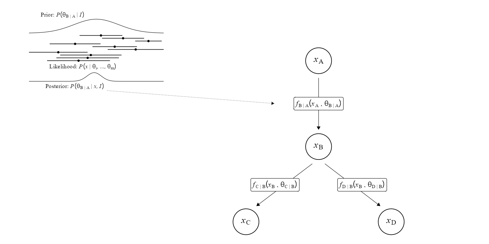

Constructing a PPMN therefore requires two related specifications: the
directed network structure and the parameterized edge-functions
associated with each incoming edge. The following section shows how
these components are defined in the package.

## Specifying network structure

We begin by defining the set of variables
($`X = \{ x_1, \ldots, x_n \}`$) that constitute the network and
specifying the directed relationships among them. Each non-root vertex
must be associated with at least one edge function that maps its parent
variable(s) ($`x_p`$) to a child vertex ($`x_c`$). An edge function is
expressed as:

``` math

x_c = f_{c|p}(x_p, \theta_{c|p})
```

where (f\_{c\|p}) represents the mathematical relationship between the
parent and child variables, and (\_{c\|p}) denotes the corresponding set
of model parameters.

As an example, consider the relationship between Total Phosphorus (TP)
and Chlorophyll-a (Chl). In the example dataset (example4), models
fitted to data from different studies provide estimates for two
parameters: the intercept (b0, (\_0)) and slope (b1, (\_1)). These
estimates can subsequently be synthesized through meta-analysis to
inform a single edge function connecting TP to Chl. The mathematical
relationship is expressed as follows:

``` math

x_{Chl}=f_{Chl|TP}(x_{TP}, \theta_{Chl|TP}) 
```
The expression above describes the relationship between the dependent
and independent variables and identifies the functional form used in the
PPMN. However, it does not explicitly show the complete mathematical
equation. The observant reader may recognize that the fitted model is
essentially a linear equation on the logarithmic scale, where the
dependent variable is modeled using a log-link function and the
independent variable is log-transformed. The deterministic component of
this GLM is therefore expressed as
($`\log(\mu_y) = \beta_0 + \beta_1 \cdot \log(x)`$), where ($`\mu_y`$)
represents the expected response. To obtain predictions on the original
response scale, we apply the inverse link function. The resulting
predictive equation is presented below.

A side note: A GLM with a log-link models $`\log(E[Y\mid x])`$, whereas
an ordinary linear regression fitted to $`\log(y)`$ models
$`E[\log(Y)\mid x]`$. These are not generally equivalent, and
exponentiating predictions from the latter does not automatically
recover the arithmetic mean of $`Y`$. Nonetheless it often provides a
decent approximation to the underlying pattern.

``` math

x_{Chl}=f_{Chl|TP}(x_{TP}, \theta_{Chl|TP}) = exp\{\beta_0 + \beta_1 \cdot Log(x_{TP})\}
```
To construct a PPMN, we first need to fit models to the available data
and extract their parameter estimates (`estimate`) and corresponding
standard errors (`error`). Additionally, we must specify the functional
relationship between the dependent and independent variables, including
any transformations applied to the independent variables.

The example data frame (`example4`), displayed below, illustrates how
this information should be organized. Six columns are required:
`function`, `transformation`, `edge`, `parameter`, `estimate`, and
`error`.

The estimate column contains the numerical estimates of the model
parameters, while error contains their corresponding standard errors.
The parameter column identifies which parameter each estimate and
standard error belong to. For a simple linear model, these are b0
($`\beta_0`$) and b1 ($`\beta_1`$), commonly referred to as the
intercept and slope, respectively.

The edge column specifies the relationship between the dependent and
independent variables using the conventional formula notation of
[`lm()`](https://rdrr.io/r/stats/lm.html) or
[`glm()`](https://rdrr.io/r/stats/glm.html), such as `Chl ~ TP`. The
transformation column indicates whether the independent variables have
been transformed. Importantly, the specified transformation is applied
to all independent variables within an edge function; individual
transformations for separate predictors are not currently supported.

The function column defines the mathematical form of the relationship
between the dependent and independent variables. The PPMN supports
different functional forms, each potentially requiring different types
and numbers of parameters. Consequently, parameters are not necessarily
restricted to intercepts and slopes. Additional functions can also be
incorporated into the library. We will return to the currently available
functions later.

Finally, `example4` includes the optional columns `Source`, `Authors`,
and `Comment`. Although these are not required to construct the PPMN,
they illustrate the additional information typically recorded during a
meta-analysis. Retaining such information is useful for documenting the
origin of parameter estimates and maintaining transparency and
traceability throughout the synthesis process.

``` r

#Load example
data("example4")

#Display head
head(example4)
#> # A tibble: 6 × 9
#>   Source Authors Comment `function` transformation edge   parameter estimate
#>   <chr>  <chr>   <lgl>   <chr>      <chr>          <chr>  <chr>        <dbl>
#> 1 A      A       NA      log        log            Chl~TP b0           -0.8 
#> 2 A      A       NA      log        log            Chl~TP b1            1.1 
#> 3 B      A       NA      log        log            Chl~TP b0           -0.2 
#> 4 B      A       NA      log        log            Chl~TP b1            0.93
#> 5 C      C       NA      log        log            Chl~TP b0           -1.1 
#> 6 C      C       NA      log        log            Chl~TP b1            1.05
#> # ℹ 1 more variable: error <dbl>
```

Each of the fitted models (Source = A, B, C, D, E) was a Generalized
Linear Model (GLM) with a log-link function and a log-transformed
independent variable. The meta-analytic data frame can contain estimates
of both the intercept and slope, although it is also possible to provide
estimates for only one of these parameters.

To identify the deterministic component of the GLM, the function column
is set to `"log"`, indicating the use of a log-link function. Since the
independent variable was also log-transformed, the transformed column is
set to `"log"`. Alternatively, a square-root transformation (`"sqrt"`)
can be specified where appropriate. If no transformation was applied to
the independent variable, the corresponding cell should be left empty.

Additional transformations can be incorporated into the HeMiE library
upon request.

## Build PPMN function

We now have a meta-analytic data frame (`example4`) containing the
information needed to synthesize the foundational PPMN, which, at this
stage, consists of a single edge function. To connect this information
to the desired network structure, we use the
[`build_ppmn()`](https://snwikaij.github.io/HeMiE/reference/build_ppmn.md)
function. This function constructs the network and performs the
meta-analysis by matching the function, edge, and transformation columns
in the data frame to the corresponding edge-function specifications.

To establish these connections, we first define a formula that uniquely
identifies each edge function, as demonstrated below. In this example,
the formula specifies the functional form using `fun = "log"`, the
relationship between the dependent and independent variables using
`edge = "Chl~TP"`, and the transformation using `trans = "log"`. If no
transformation is required, the trans argument can simply be omitted
from the formula.

``` r

#We need to create a formula
formula=list(c(fun="log", edge="Chl~TP", trans="log"))
```

The PPMN aims to make combine all potential available information. To
achieve this, it employs an empirical Bayesian meta-analysis that
combines parameter estimates obtained from published studies with prior
information that cannot be directly incorporated through model fitting,
such as expert opinion or theoretical expectations.

Both the prior distributions and the sampling distributions of the
estimated parameters are assumed to follow a Gaussian distribution.
Consequently, each parameter is characterized by its mean (mu, $`\mu`$)
and standard error (se). For each parameter b_0, b_1, …, b_n within an
edge function, the prior mean is specified using `prior_mu_b0`,
`prior_mu_b1`, and so forth, while the corresponding prior standard
error is specified using `prior_se_b0`, `prior_se_b1`, etc.

If no prior information is provided, the prior mean defaults to 0 and
the prior standard error to 1000, representing a weakly informative
default prior over a broad parameter range.

Additionally, prior distributions can be truncated to restrict parameter
values to a predefined range. The lower truncation boundary is specified
using `trunc_a_b0`, `trunc_a_b1`, etc., while the upper boundary is
specified using `trunc_b_b0`, `trunc_b_b1`, etc. This allows ecological
or theoretical constraints, such as requiring a parameter to be strictly
positive or negative, to be incorporated directly into the prior
specification.

``` r

formula=list(c(fun="log", edge="Chl~TP", trans="log",
               prior_mu_b0=-0.5, prior_se_b0=0.5,
               prior_mu_b1=1, prior_se_b1=0.5, trunc_a_b1=0))
```

In our example, we assume that prior information about the model
parameters is already available. For the intercept ($`\beta_0`$), we
specify a normal prior distribution with a mean of $`−0.5`$ and a
standard deviation of $`0.5`$. This gives an approximate 95% interval
ranging from $`-0.5 - 2 \cdot 0.5 = -1.5`$ to
$`-0.5 + 2 \cdot 0.5 = 0.5`$.

Similarly, for the slope ((\_1)), we specify a normal prior distribution
with a mean of 1 and a standard deviation of 0.5, resulting in an
approximate 95% interval between (1 - 2 = 0) and (1 + 2 = 2).
Additionally, we assume that the relationship between TP and Chl must be
positive. We therefore truncate the slope’s prior distribution at zero
by specifying trunc_a_b1 = 0, excluding negative parameter values.

Together, these prior specifications and the model formula define a
single edge function connecting TP to Chl.

At this point, we have all the necessary ingredients to construct the
foundational PPMN: the network formula, prior information, and
meta-data. These can now be supplied to the
[`build_ppmn()`](https://snwikaij.github.io/HeMiE/reference/build_ppmn.md)
function, as demonstrated below.

``` r

foundational_ppmn <- build_ppmn(formula = formula, data = example4,
                                vertex_height = 0.14,
                                vertex_width = 0.02,
                                fun_width = 0.1,
                                fun_height = 0.25)
```

After constructing the foundational PPMN, the relationship represented
by the single edge function can be visualized as a Directed Acyclic
Graph (DAG), illustrating the direction of the association between the
parent and child variables.

``` r

foundational_ppmn$PlotDAG
```

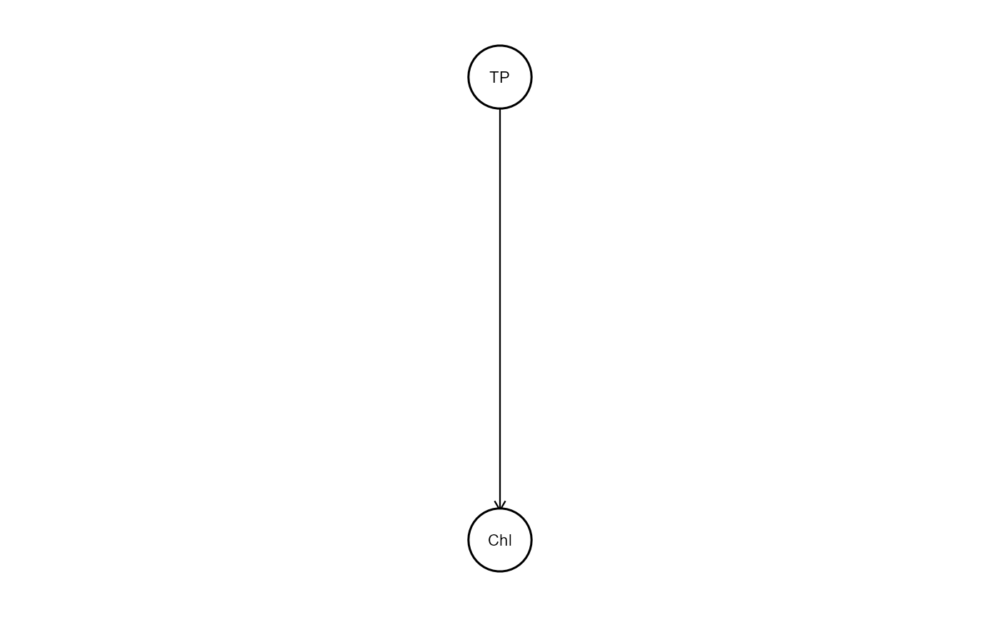

Alternatively, the network can be visualized as a Directed Bipartite
Network (DBN), in which circles represent the variables (vertices) and
boxes represent the edge functions connecting them. The arrows indicate
the direction of the relationships within the network.

``` r

foundational_ppmn$PlotDBN
```

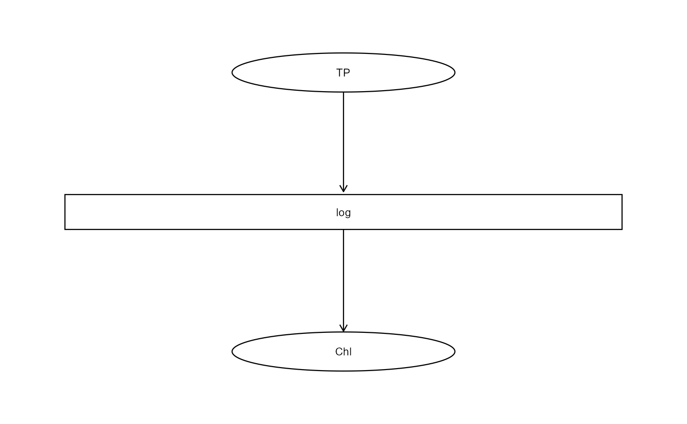

A slightly more complex example illustrates how multiple predictors can
be incorporated into an edge function and how successive edge functions
can be connected within a network. Suppose we wish to predict
chlorophyll-a (Chl) concentrations from total nitrogen (TN) and total
phosphorus (TP), expressed as *Chl ~ TN + TP*. The predicted
chlorophyll-a concentration is then used to estimate phytoplankton taxa
richness (*Taxa ~ Chl*). Together, these two edge functions form a
network in which TN and TP are connected to taxa richness through Chl.
The mathematical expressions defining both edge functions are provided
below.

``` math

f_{Chl|TN, TP}(.) = f_{Chl|TN, TP}(x_{TN}, x_{TP}, \theta_{Chl|TN,TP,1},  \theta_{Chl|TN,TP,2}) = exp\{\beta_0 + \beta_1 \cdot Log(x_{TN}) + 
```
and

``` math

f_{Taxa|Chl}(.)=f_{Taxa|Chl}(x_{Chl}, \theta_{Taxa|Chl})=exp(\beta_0 + \beta_1 \cdot Log(x_{Chl}))
```

Both edge functions are then combined into a single network, as
illustrated below.

``` math

f_{Taxa|Chl}(f_{Chl|TN, TP}(x_{TN}, x_{TP}, \theta_{Chl|TN,TP,1},  \theta_{Chl|TN,TP,2}), \theta_{Taxa|Chl})
```

The network formula is specified below. One additional feature is the
inclusion of two alternative priors for the edge function *Taxa ~ Chl*.
Suppose two independent researchers, managers, or estimation methods
provide different prior expectations for the same model parameters.
Rather than selecting one source a priori, both can be incorporated to
represent uncertainty arising from alternative sources of information.
The meta-analytic component of the PPMN combines these alternative prior
specifications through Bayesian Model Averaging (BMA), allowing each to
contribute to the synthesized parameter estimates.

After constructing the foundational PPMN, we visualize its structure as
a DBN, providing a graphical overview of the variables and their
relationships.

``` r

#Load example
data(example5)

#Display first rows
head(example5)
#> # A tibble: 6 × 9
#>   Source Authors Comment `function` transformation edge      parameter estimate
#>   <chr>  <chr>   <lgl>   <chr>      <chr>          <chr>     <chr>        <dbl>
#> 1 A      A       NA      log        log            Chl~TN+TP b0           -0.8 
#> 2 A      A       NA      log        log            Chl~TN+TP b1            0.34
#> 3 A      A       NA      log        log            Chl~TN+TP b2            1.1 
#> 4 B      B       NA      log        log            Chl~TN+TP b0           -0.2 
#> 5 B      B       NA      log        log            Chl~TN+TP b1            0.7 
#> 6 B      B       NA      log        log            Chl~TN+TP b2            0.93
#> # ℹ 1 more variable: error <dbl>

#Create a formula
formula=list(c(fun="log", edge="Chl~TN+TP", trans="log",
               prior_mu_b0=-0.5, prior_se_b0=0.5,
               prior_mu_b1=0.5, prior_se_b1=0.5, trunc_a_b1=0,
               prior_mu_b2=1, prior_se_b2=0.5, trunc_a_b2=0),
             
             c(fun="log", edge="Taxa~Chl", trans="log",
               prior_mu_b0=0, prior_se_b0=5,
               prior_mu_b1=c(0.3, 0.5), prior_se_b1=c(0.5, 1), trunc_a_b1=0))

#Build the foundational PPMN
foundational_ppmn <- build_ppmn(formula = formula, data = example5, 
                                vertex_width = 0.07,
                                fun_width = 0.08)

#Display the Directed Bipartite Network
foundational_ppmn$PlotDBN
```

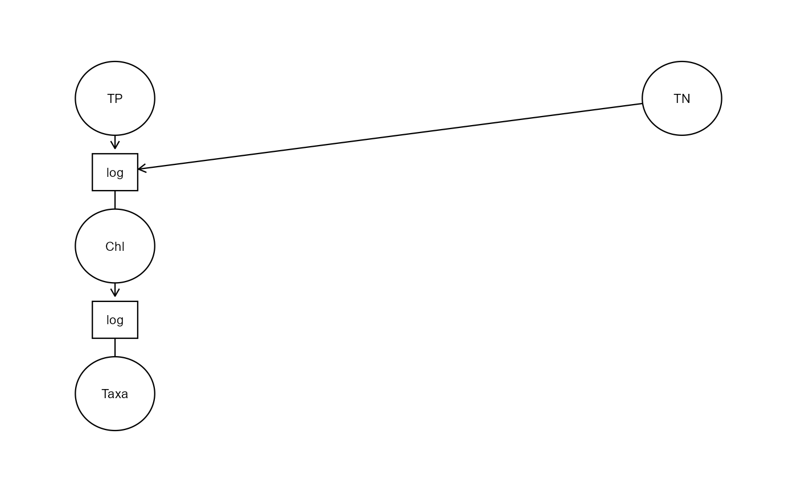

We can also inspect the structure of the synthesized PPMN by displaying
a summary of the network in tabular form. The summary provides an
overview of the number of vertices, the total number of synthesized
parameters, and the number of parameter estimates obtained from the
meta-data. This is followed by a detailed table describing each edge
function, including its corresponding edge, functional form, dependent
and independent variables, and any additional information required to
specify the function. Together, these tables provide a structured
overview of the network and the information used to construct it.

``` r

#print the summary.
print(foundational_ppmn)
#> 
#> Posterior Predictive Meta-Analytic Network
#> -------------------------------------------
#> 
#> Vertices               : 4 
#> Synthesized parameters : 5 
#> Parameter estimates    : 15 
#> Updates                : 0 
#> 
#>       edge edge function dependent independent parameters     mu    se     ll
#>  Chl~TN+TP           log       Chl        <NA>         b0 -0.661 0.211 -1.009
#>  Chl~TN+TP           log       Chl          TN         b1  0.414 0.089  0.268
#>  Chl~TN+TP           log       Chl          TP         b2  1.015 0.190  0.702
#>   Taxa~Chl           log      Taxa        <NA>         b0  1.013 0.162  0.747
#>   Taxa~Chl           log      Taxa         Chl         b1  0.488 0.061  0.388
#>      ul     sd tau2 I2    a   b n
#>  -0.314 0.2113    0  0 -Inf Inf 3
#>   0.560 0.0888    0  0    0 Inf 3
#>   1.328 0.1901    0  0    0 Inf 3
#>   1.278 0.1616    0  0 -Inf Inf 3
#>   0.588 0.0606    0  0    0 Inf 3
```

## Marginal PPMN function

The network structure provides only one perspective on the information
incorporated into the PPMN. As demonstrated by Kaijser et al. (2025), we
may also be interested in examining individual associations by
visualizing the marginal predictions of each edge function in an added
variable plot. To illustrate this, we first create an example data
frame, as shown below. If no observed data are available, or if we wish
to display only the model predictions, the data points can be hidden by
setting the argument `alpha = 0`.

``` r

library(cowplot)

df <- data.frame(TN=c(0.1, 1.25, 3.2, 2.23, 5), 
                 TP=c(5, 11, 27, 42, 83), 
                 Chl=c(0.2, 21, 30, 48, 92),
                 Taxa=c(4, 3, 9, 14, 25))

marginal_fig_Chl  <- marginal_ppmn(foundational_ppmn, child = "Chl", data =  df)
marginal_fig_Taxa <- marginal_ppmn(foundational_ppmn, child = "Taxa", data =  df)

cowplot::plot_grid(marginal_fig_Chl[[1]], #First object is TN
                   marginal_fig_Chl[[2]], #Second object is TP
                   marginal_fig_Taxa[[1]],#This is Chl 
                   ncol=1, labels = "AUTO")
```

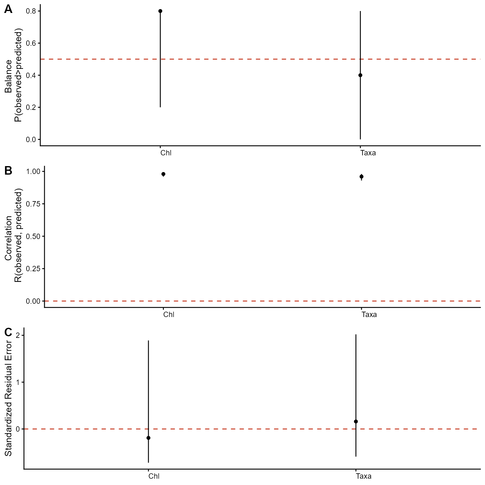

## Predictive fit function

he
[`pred_fit_ppmn()`](https://snwikaij.github.io/HeMiE/reference/pred_fit_ppmn.md)
function evaluates the predictive performance of the PPMN on new data
using three complementary metrics: Balance, Correlation, and
Standardized Residual Error (SRE).

Balance measures the proportion of observations that exceed their
corresponding predictions, expressed as ($`P(x > \hat{x})`$), where
($`x`$) represents the observed value and ($`\hat{x}`$) the predicted
value. This metric assesses whether the predictions are generally
centered within the observed data. Values close to 0.5 indicate
relatively balanced predictions, whereas values approaching 0 indicate
that the model tends to overpredict the observations. Conversely, values
approaching 1 indicate that the model tends to underpredict the
observations.

``` math

P(observed>predicted)=\frac{1}{N}\sum_{s=1}^S H(x_c > \hat x_c^{(s)})
```

measures the strength and direction of the linear relationship between
observed and predicted values. A correlation close to 1 indicates a
strong positive association, suggesting that predictions increase as
observed values increase. A correlation close to 0 indicates little or
no linear association between observations and predictions, whereas a
negative correlation indicates that predictions tend to change in the
opposite direction to the observations. Values approaching −1 indicate a
strong negative linear relationship.

``` math

R(observed > predicted) = \frac{Cov(x_c, \hat x_c^{(s)})}{\sqrt{Var(x_c)\cdot Var(\hat x_c^{(s)}})}
```

The standardize residual error (SRE) is calculated by dividing the
residual error for each child vertex ($`c`$) and Monte Carlo simulation
($`s`$) by the estimated standard deviation of the corresponding
residual distribution. The SRE expresses the magnitude of prediction
errors relative to the variability of the residuals. Values close to 0
indicate that predictions closely match the observed values, whereas an
absolute SRE of approximately 1 indicates that the prediction error is
equivalent to one estimated standard deviation of the residual
distribution. Absolute values of 3 or higher indicate particularly large
deviations between observed and predicted values, require further
investigation.

``` math

SRE_c=\frac{r_c^{(s)}}{\sigma(r_c)}
```

The example below demonstrates how to apply the
[`pred_fit_ppmn()`](https://snwikaij.github.io/HeMiE/reference/pred_fit_ppmn.md)
function to assess the predictive performance of the PPMN using the
example data set introduced above.

``` r

#Apply the pred_fit function
pred_performance <- pred_fit_ppmn(object = foundational_ppmn, new_data = df)

#Plot the results together
cowplot::plot_grid(pred_performance$plots$Balance, #Predictive balance
                   pred_performance$plots$Correlation, #Predictive correlation
                   pred_performance$plots$Stdz, #Predictive precision
                   ncol=1, labels = "AUTO")
```

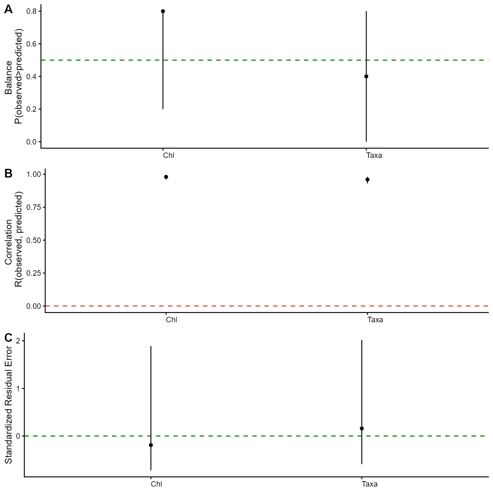

## Updating the PPMN

### Specifying network structure

We will now construct a more elaborate PPMN by following the steps
outlined above and subsequently update it using additional data. First,
we define the network structure by specifying the formula that describes
the relationships between its variables.

``` r

#Load example
data(example6)

#Display head
head(example6)
#> # A tibble: 6 × 10
#>   Source         Authors Type  Comment `function` transformation edge  parameter
#>   <chr>          <chr>   <chr> <chr>   <chr>      <chr>          <chr> <chr>    
#> 1 Macrophyte gr… Kaijse… Raw … NA      class      NA             Char… b0       
#> 2 Macrophyte gr… Kaijse… Raw … NA      class      NA             Char… b1       
#> 3 Macrophyte gr… Kaijse… Raw … NA      class      NA             Char… b2       
#> 4 Macrophyte gr… Kaijse… Raw … NA      class      NA             Char… b3       
#> 5 Macrophyte gr… Kaijse… Raw … NA      class      NA             Char… b4       
#> 6 Charophyte va… Kolada… Supp… NA      class      NA             Char… b0       
#> # ℹ 2 more variables: estimate <dbl>, error <dbl>

#Set the formula of the full network
formula=list(c(fun="sigmoidal", edge="Chl~TP", trans="log",
               prior_mu_b0=100, prior_se_b0=50, trunc_a_b0=0,
               prior_mu_b1=6.2, prior_se_b1=1.6,
               prior_mu_b2=0.15, prior_se_b2=1, trunc_a_b2=0),

             c(fun="log10", edge="Chl~TP", trans="log10"),

             c(fun="log", edge="Macrophytes~Chl+Temp+CO2onlyuser", trans="log"),

             c(fun="class", edge="Characeae~Chl"),

             c(fun="sigmoidal", edge="pH~Chl"),

             c(fun="sigmoidal", edge="CO2~pH"),

             c(fun="logit", edge="CO2onlyuser~HCO3", trans="log"),

             c(fun="log", edge="DOC~Chl", trans="log"),

             c(fun="log",  trans="log", edge="DO~DOC+Temp"),

             c(fun="sigmoidal", edge="HCO3~pH"))

#Build the PPMN and define size of the vertices
foundational_ppmn <- build_ppmn(formula = formula, data = example6, txt_size = 3, vertex_height = 0.3, vertex_width = 0.30, arrow_offset = 5)

#Display graph as directed bipartite network
foundational_ppmn$PlotDBN
```

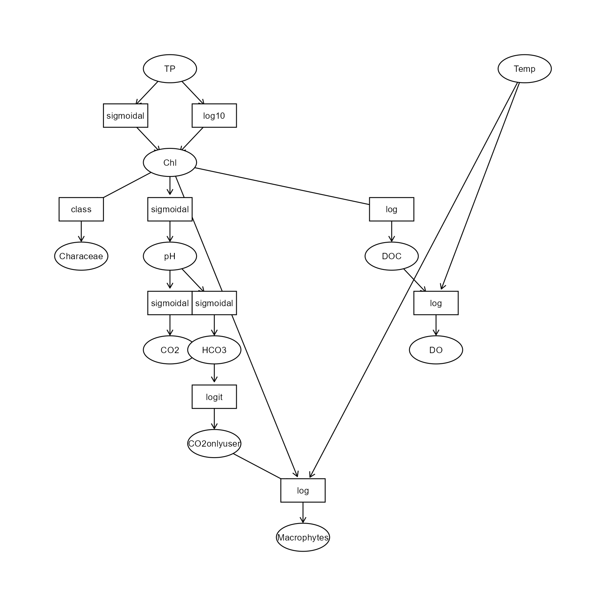

The complete foundational PPMN has now been constructed, and all
previously introduced functions can be applied. However, we are
particularly interested in updating the PPMN so that it can learn the
joint multivariate constraints present in new data. This allows the
network to improve its predictions even when only information about the
root variables is provided. To achieve this, the update_ppmn() function
can be applied using its default settings and an additional data set.
Through Generalized Bayesian Updating, the PPMN adjusts its parameter
distributions to better reflect the multivariate relationships observed
in the new data, while retaining information synthesized in the
foundational network.

### Default training mode

``` r

#Load example of training data
data(train_data)

#Display head
head(train_data)
#> # A tibble: 6 × 10
#>      TP  Temp   Chl    pH  HCO3    DO Characeae Macrophytes CO2onlyuser   DOC
#>   <dbl> <dbl> <dbl> <dbl> <dbl> <dbl>     <dbl>       <dbl>       <dbl> <dbl>
#> 1   6    9.30  7.05  5.94   NA   5.50         0           6       0.833 NA   
#> 2  46   16.7   7.9   8.2   146.  6.04         1          16       0.375 NA   
#> 3  86.6 14.4  11     7.84   NA   6.96         1          24       0.292  8.35
#> 4 195.   7.8  22.4   8.79   NA  12.5          0           7       0.286 NA   
#> 5  44.6 19    13     7.85   NA   8.68         1          14       0.286 NA   
#> 6  12.0 17.0   2.6   5.86   NA  NA            0           6       0.833 NA

#Update the foundational ppmn
updated_ppmn <- update_ppmn(object = foundational_ppmn, new_data = train_data)

#Display the residuals
updated_ppmn$Residuals$resid_boxplot
```

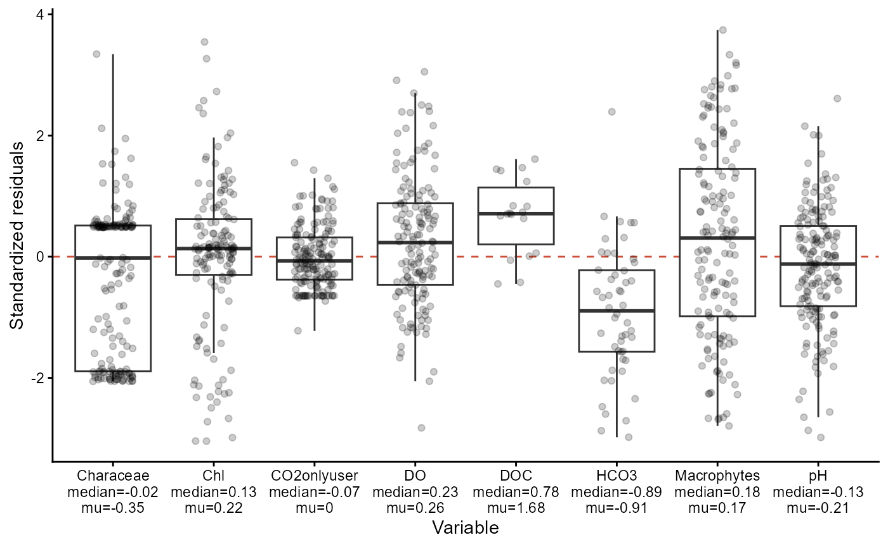

Eye-balling the residual distributions suggests that the PPMN generally
produces reasonably centered predictions. For most variables, zero falls
within the interquartile range (25th–75th percentiles), indicating
relatively limited systematic deviation between observed and predicted
values. DOC and HCO3 are notable exceptions, showing a greater
displacement from zero. However, these deviations are not particularly
extreme, as zero still falls within the wider interval defined by the
5th and 95th percentiles. Nevertheless, these discrepancies warrant
further investigation by examining the marginal predictions of both
variables.

``` r

#check the marginal curve of the edge function predicting DOC
pl_doc  <- marginal_ppmn(updated_ppmn, data = train_data, child = "DOC")

#check the marginal curve of the edge function predicting HCO3
pl_hco3 <- marginal_ppmn(updated_ppmn, data = train_data, child = "HCO3")

cowplot::plot_grid(pl_doc[[1]], pl_hco3[[1]], labels = "AUTO")
```

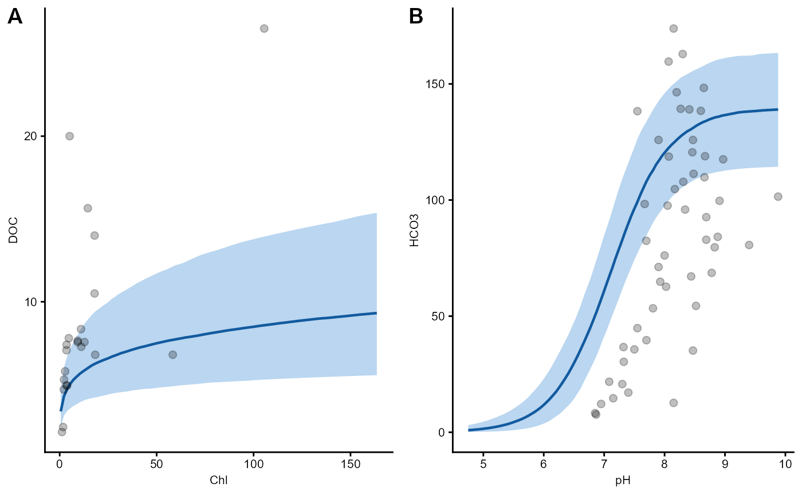 Although the marginal
predictions of the PPMN generally follow the observed data, the updating
procedure optimizes predictive loss across the entire network rather
than fitting each edge function independently. Because the new dataset
is relatively sparse, with many missing observations, the information
available to constrain individual relationships is limited.
Consequently, discrepancies in particular marginal predictions may have
relatively little influence on the overall update.

Furthermore, the foundational PPMN synthesizes information from numerous
published studies, whereas the newly provided data set represents only a
single additional study. This raises a question: should the model
disregard all previously accumulated information to achieve a near
perfect fit to the new observations? Arguably not. The purpose of
Generalized Bayesian Updating is not to replace previous information
with each new data set, but to integrate new information with existing
expectations. Disagreement between the model and new observations should
therefore be evaluated critically, rather than automatically forcing the
model to conform to the latest data.

### Multi-edge function

The PPMN allows multiple competing edge functions to predict the same
child variable. In the network presented above, for example, the
historical log-linear relationship,
($`\log_{10}(Chl) = \beta_0 + \beta_1 \cdot \log_{10}(TP)`$), competes
with a sigmoidal function describing the same relationship.

Initially, all competing edge functions are assigned equal weights,
calculated as (1/M), where (M) is the number of competing functions. In
this example, both functions therefore receive an initial weight of (1/2
= 0.5). As more competing edge functions are introduced, their
individual initial weights decrease accordingly.

When new data become available, these weights are updated according to
the relative predictive performance of the competing functions.
Functions that better predict the observed data receive greater weights,
increasing their contribution to subsequent predictions. In this way,
the PPMN can learn which functional relationships are better supported
by the available data without requiring a single edge function to be
selected a priori.

``` r

#foundational weights for the multi-edge function
foundational_ppmn$FunctionWeights$Chl
#> ef1 ef2 
#> 0.5 0.5

#update weights for the multi-edge function
updated_ppmn$FunctionWeights$Chl
#>        ef1        ef2 
#> 0.97179641 0.02820359

#what is the id of ef1 (edge function1) and ef2 (edge function2) 
updated_ppmn$EdgeFunctions
#>      id       child f                             edge       fun trans
#> 1   ef1         Chl 1                           Chl~TP sigmoidal   log
#> 2   ef2         Chl 2                           Chl~TP     log10 log10
#> 3   ef3 Macrophytes 1 Macrophytes~Chl+Temp+CO2onlyuser       log   log
#> 4   ef4   Characeae 1                    Characeae~Chl     class  <NA>
#> 5   ef5          pH 1                           pH~Chl sigmoidal  <NA>
#> 6   ef6         CO2 1                           CO2~pH sigmoidal  <NA>
#> 7   ef7 CO2onlyuser 1                 CO2onlyuser~HCO3     logit   log
#> 8   ef8         DOC 1                          DOC~Chl       log   log
#> 9   ef9          DO 1                      DO~DOC+Temp       log   log
#> 10 ef10        HCO3 1                          HCO3~pH sigmoidal  <NA>
#>                 parents
#> 1                    TP
#> 2                    TP
#> 3  Chl+Temp+CO2onlyuser
#> 4                   Chl
#> 5                   Chl
#> 6                    pH
#> 7                  HCO3
#> 8                   Chl
#> 9              DOC+Temp
#> 10                   pH
```

Following Generalized Bayesian Updating (GBU), the weight assigned to
the sigmoidal function increased from 50% to 93%, whereas the weight of
the log10-log10-linear function decreased from 50% to 7%. These
substantial shifts indicate that the observed data are better predicted
by the sigmoidal function.

Initially, both functions were considered equally plausible, with
weights of 0.5 each. After updating, the sigmoidal function accounts for
93% of the combined model weight. We can express this change in relative
support using a quantity analogous to a Bayes factor.

Under conventional Bayesian model comparison, the posterior odds between
two competing hypotheses are given by:
``` math

\frac{P(f_{\mathrm{sigmoidal}}\mid x)}{P(f_{\mathrm{log_{10}}}\mid x)}
=
\underbrace{
\frac{P(x\mid f_{\mathrm{sigmoidal}})}{P(x\mid f_{\mathrm{log_{10}}})}
}_{\text{Bayes factor}}
\cdot
\frac{P(f_{\mathrm{sig}})}{P(f_{\mathrm{log_{10}}})}
```
The Bayes factor therefore describes how much the observed data change
the relative support for competing models. By analogy, we can calculate
a loss-based pseudo-Bayes factor from the ratio of updated to initial
model odds:

``` math

\frac{0.93/0.07}{0.50/0.50}
\approx 13.3
```
Thus, the relative support for the sigmoidal function has increased
approximately 13-fold compared with the log10-log10-linear function.

Importantly, this quantity is not a conventional Bayes factor. The PPMN
uses Generalized Bayesian Updating, which updates parameter and model
weights through loss functions rather than an explicitly specified
likelihood. Consequently, the resulting pseudo-Bayes factor should be
interpreted as a measure of the change in relative model support under
the chosen loss function and learning rate, rather than as a ratio of
marginal likelihoods.

Nevertheless, it provides an intuitive way to quantify how strongly the
available data favor one competing edge function over another.

``` r

#check the marginal curve of the multi-edge function before updating
pl_chl1  <- marginal_ppmn(foundational_ppmn, data = train_data, child = "Chl")

#check the marginal curve of the edge function predicting HCO3
pl_chl2 <- marginal_ppmn(updated_ppmn, data = train_data, child = "Chl")

cowplot::plot_grid(pl_chl1[[3]], pl_chl2[[3]], labels = "AUTO")
```

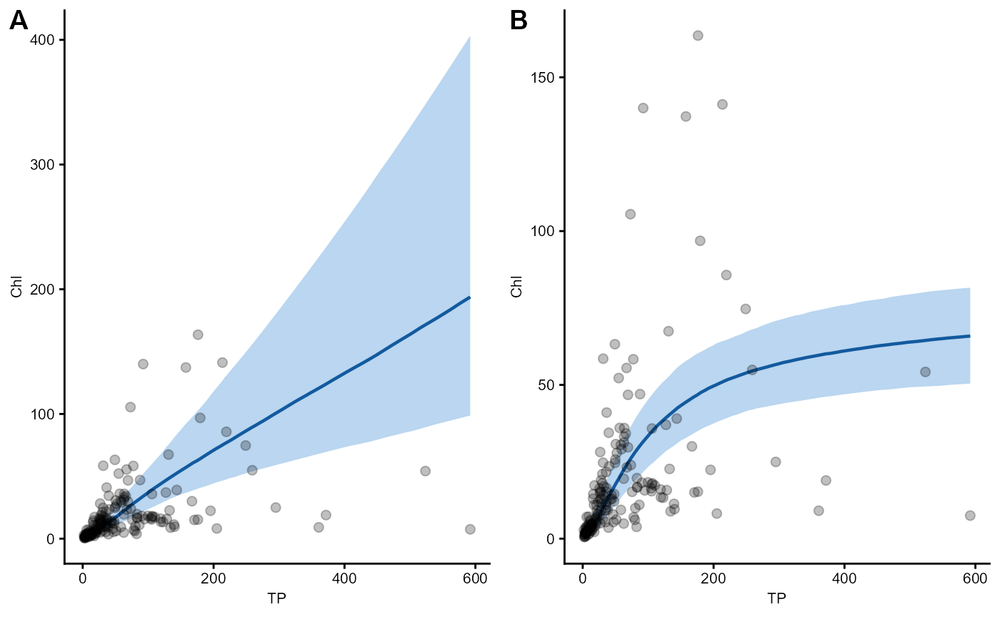

### Fixed information gain training

It is also possible to manually control the strength of Generalized
Bayesian Updating (GBU), thereby influencing how strongly the
generalized posterior concentrates around the best performing parameter
combinations. This is achieved by setting `method = "manual"` and
specifying up_character as a proportion between 0 and 1. The learning
rate ($`\lambda`$) is then determined indirectly from the fraction of
particles with the lowest predictive loss, assigning greater weight to
better performing parameter combinations. This allows the user to
control posterior concentration rather than relying on the default
hold-out calibration.

``` r

#Update the foundational ppmn allowing the data to dominate by 95%
updated_ppmn_5 <- update_ppmn(object = foundational_ppmn, new_data = train_data, method = "manual", up_character = 0.05)

#Update the foundational ppmn allowing the data to dominate by 80%
updated_ppmn_50 <- update_ppmn(object = foundational_ppmn, new_data = train_data, method = "manual", up_character = 0.2)

#Update the foundational ppmn allowing the data to dominate by 50%
updated_ppmn_95 <- update_ppmn(object = foundational_ppmn, new_data = train_data, method = "manual", up_character = 0.5)

#Display the residuals on top of each other
cowplot::plot_grid(
  updated_ppmn_5$Residuals$resid_boxplot,
  updated_ppmn_50$Residuals$resid_boxplot,
  updated_ppmn_95$Residuals$resid_boxplot,
  ncol=1, labels=c("Best 5%",
                   "Best 20%",
                   "Best 50%"),
  label_y=1.02, label_x=1.25)
```

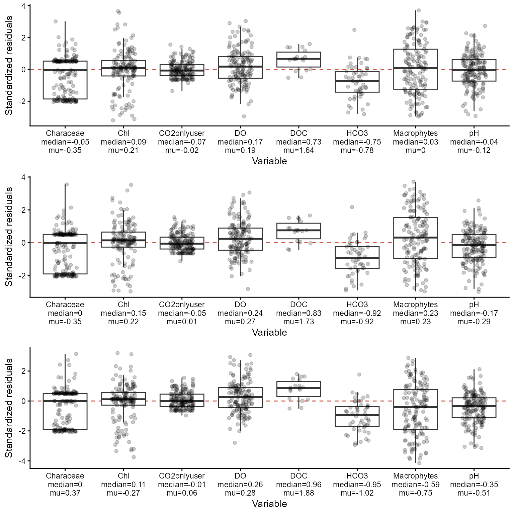

The text below each boxplot provides the median and mean (mu) of the
residuals, indicating how well they are centered around zero. For
Characeae, which is a binary response variable, the residuals are
standardized using Pearson residuals, dividing the difference between
observed and predicted values by the expected standard deviation,
$`\sqrt{p\cdot (1-p)}`$. Although this standardization is appropriate
for binary data, the residual distribution remains discrete and
potentially asymmetric, particularly because the observations are
dominated by presences. This explains the visible gap in the
distribution of residuals for Characeae.

Overall, the residuals of most variables appear reasonably well centered
around zero, with the notable exceptions of DOC and HCO3. These
deviations are consistent with the discrepancies identified earlier when
examining the marginal predictions of the PPMN.

### Display marginal trends

``` r

#Create the marginal plots
marginal_fig_HCO3 <- marginal_ppmn(updated_ppmn, child = "HCO3", data = train_data)
marginal_fig_DOC  <- marginal_ppmn(updated_ppmn, child = "DOC", data = train_data)

#Plot them togheter
cowplot::plot_grid(marginal_fig_HCO3[[1]], 
                   marginal_fig_DOC[[1]], 
                   ncol=1, labels = "AUTO")
```

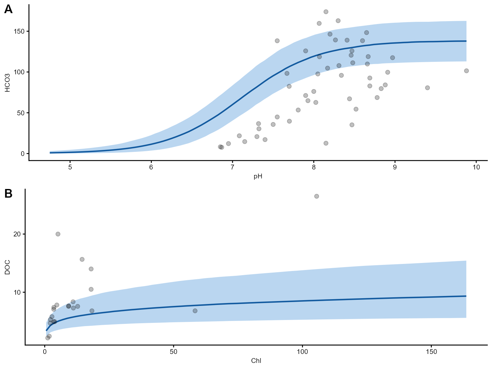

Examining these figures provides a clearer understanding of why the
residuals for HCO3 are shifted: the PPMN systematically over or under
predicts the observed values. For DOC, the discrepancy is even more
apparent, as the log-linear edge function appears not to represent the
pattern observed in the new data.

There are at least three plausible explanations for these discrepancies:
(1) the selected edge function does not adequately describe the
underlying relationship; (2) the information obtained from the
literature is insufficient (not enough samples) or does not accurately
represent the relationship; or (3) the new data are of insufficient
quality or are not representative of the conditions the model is
intended to describe.

Determining which explanation is most plausible requires further
investigation and discussion. Importantly, identifying disagreement
between the model and the data should not be regarded as a failure. Such
discrepancies may be inconvenient or contradict our expectations, but
they should not be ignored simply because they are undesirable. Instead,
they provide an learning opportunity.

### Apply predictive fit to validation data

``` r

#Assess the performance of the updated ppmn on the validation data 
pred_fit_val  <- pred_fit_ppmn(updated_ppmn, val_data, rotate_x = 45, hjust = 1)

#Plot the results of the updated model applied on the validation data
cowplot::plot_grid(pred_fit_val$plots$Balance,
                   pred_fit_val$plots$Correlation,
                   pred_fit_val$plots$Stdz,
                   labels="AUTO", ncol=1)
```

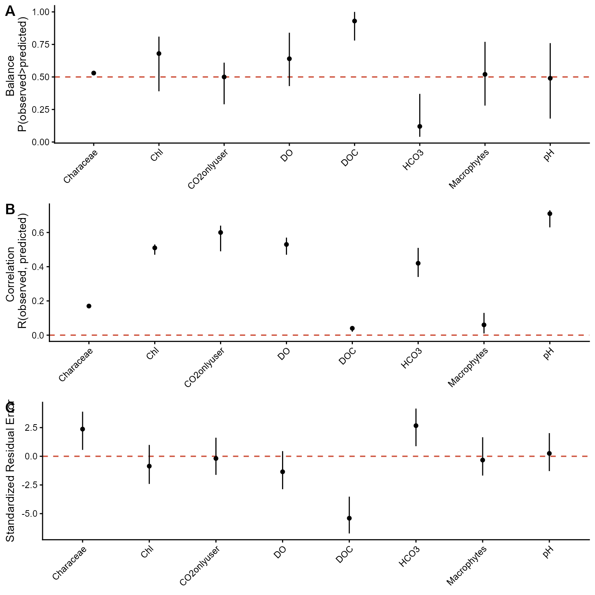

Also here we see that HCO3 and DOC deviate. Based on this I accept the
deviation of HCO3. I have another data set that only contains HCO3~pH
containing which shows a ‘perfect’ fit. However, DOC~Chl I can not
explain properly. This would need further explanation from literature.
Having assessed on the validation data we could accepted the
discrepancies and notate them or update on another data, or reconstruct
the PPMN.

### Displacement test

The displacement test evaluates how much the PPMN’s predictions would
need to shift to best align its central predictions with a new dataset.
To assess this, we compare the predictions obtained from a
data-dominated update with those of the original PPMN. If the
best-fitting predictions fall substantially outside the range of prior
predictions, this indicates disagreement between the model’s
expectations and the observed data. Conversely, if little or no
displacement is required, the original predictions are already well
aligned with the data.

The table below shows that DOC is the only variable exhibiting
substantial disagreement with the model. The accompanying forest plot
illustrates the magnitude and direction of displacement for each
variable. Importantly, displacement does not tell us whether the
discrepancy originates from the model or the data. It simply identifies
where the observations and the model’s prior expectations disagree.

``` r

disp_test  <- disp_ppmn(updated_ppmn, val_data)

print(disp_test)
#> 
#> Displacement
#> -----------------
#> 
#>     Variable median    map     mu     ll     ul
#>          Chl -0.107 -0.095 -0.055 -0.505  0.646
#>           pH  0.262  0.283  0.230 -0.622  0.956
#>         HCO3  0.129  0.136  0.122 -0.801  0.999
#>           DO -0.808 -1.005 -0.766 -1.891  0.477
#>    Characeae  0.195  0.236 -0.016 -1.270  0.476
#>  Macrophytes -0.388 -0.457 -0.307 -1.131  0.744
#>  CO2onlyuser  0.377  0.360  0.440 -0.517  1.729
#>          DOC -2.268 -2.213 -2.212 -3.327 -0.912

disp_test$plot
```

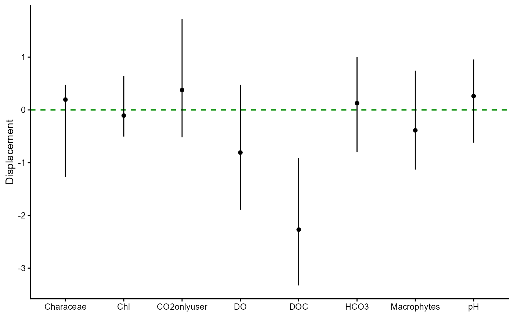

### Correlation matrix and parameter extraction

Although the parameter estimates and correlation matrix can be extracted
directly from the PPMN object, the HeMiE package provides two
convenience functions,
[`extract_covar_ppmn()`](https://snwikaij.github.io/HeMiE/reference/extract_covar_ppmn.md)
and
[`extract_param_ppmn()`](https://snwikaij.github.io/HeMiE/reference/extract_param_ppmn.md),
to simplify this process. These functions allow users to inspect the
synthesized parameter estimates and the correlation structure between
parameters without manually extracting and organizing the information.
An example demonstrating their use is provided below.

``` r

cor_mat <- extract_covar_ppmn(updated_ppmn)

cor_mat$corplot
```

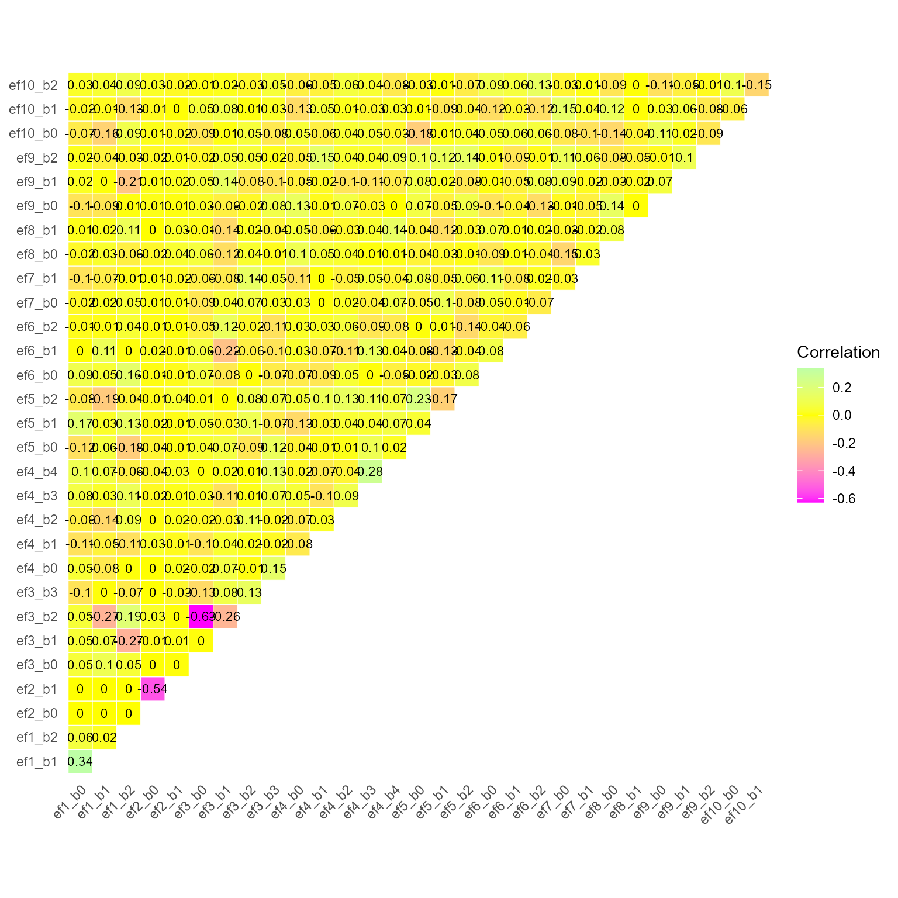

The following function can be used to extract the parameter estimates
from the PPMN, providing both the prior and generalized posterior
estimates for comparison.

``` r

params <- extract_param_ppmn(updated_ppmn)

print(params)
#> 
#> PPMN parameter estimates
#> ------------------------
#> 
#> Prior parameters
#> ----------------
#>    ef parameter      mu      ll      ul
#>   ef1        b0  71.534  49.350  93.719
#>   ef1        b1   4.651   4.183   5.119
#>   ef1        b2   0.616   0.471   0.762
#>   ef2        b0  -0.812  -1.004  -0.620
#>   ef2        b1   1.198   1.086   1.309
#>   ef3        b0   2.621   2.164   3.078
#>   ef3        b1  -0.310  -0.398  -0.221
#>   ef3        b2   0.079  -0.417   0.575
#>   ef3        b3  -0.338  -0.389  -0.286
#>   ef4        b0  11.739   7.777  15.700
#>   ef4        b1  13.204  12.360  14.047
#>   ef4        b2  38.497  34.840  42.154
#>   ef4        b3  38.634  36.040  41.228
#>   ef4        b4   0.525   0.495   0.556
#>   ef5        b0   8.830   8.216   9.444
#>   ef5        b1  -6.376  -9.697  -3.055
#>   ef5        b2   5.717   3.071   8.363
#>   ef6        b0  60.027  17.379 102.675
#>   ef6        b1   6.775   5.805   7.744
#>   ef6        b2  -0.350  -0.515  -0.184
#>   ef7        b0   2.771   2.582   2.960
#>   ef7        b1  -0.742  -0.790  -0.694
#>   ef8        b0   1.290   0.969   1.611
#>   ef8        b1   0.170   0.096   0.243
#>   ef9        b0   2.890   2.803   2.977
#>   ef9        b1  -0.039  -0.078   0.001
#>   ef9        b2  -0.232  -0.276  -0.187
#>  ef10        b0 141.637 117.310 165.964
#>  ef10        b1   7.102   6.869   7.336
#>  ef10        b2   0.477   0.342   0.612
#> 
#> Generalized posterior parameters
#> --------------------------------
#>    ef parameter      mu      ll      ul
#>   ef1        b0  69.578  51.046  91.045
#>   ef1        b1   4.602   4.242   4.967
#>   ef1        b2   0.670   0.543   0.796
#>   ef2        b0  -0.916  -1.080  -0.766
#>   ef2        b1   1.108   1.026   1.174
#>   ef3        b0   2.549   2.152   2.961
#>   ef3        b1  -0.284  -0.372  -0.188
#>   ef3        b2  -0.031  -0.266   0.181
#>   ef3        b3  -0.339  -0.392  -0.283
#>   ef4        b0  11.565   7.141  16.049
#>   ef4        b1  13.223  12.451  13.909
#>   ef4        b2  38.689  35.104  42.757
#>   ef4        b3  38.591  35.730  41.166
#>   ef4        b4   0.523   0.495   0.553
#>   ef5        b0   8.705   8.238   9.167
#>   ef5        b1  -5.863  -9.290  -3.023
#>   ef5        b2   6.321   4.067   9.056
#>   ef6        b0  60.027  17.379 102.675
#>   ef6        b1   6.775   5.805   7.744
#>   ef6        b2  -0.350  -0.515  -0.184
#>   ef7        b0   2.766   2.578   2.954
#>   ef7        b1  -0.744  -0.792  -0.701
#>   ef8        b0   1.327   0.969   1.647
#>   ef8        b1   0.179   0.109   0.249
#>   ef9        b0   2.893   2.821   2.984
#>   ef9        b1  -0.037  -0.076   0.011
#>   ef9        b2  -0.227  -0.269  -0.189
#>  ef10        b0 141.099 117.259 163.183
#>  ef10        b1   7.118   6.881   7.331
#>  ef10        b2   0.471   0.335   0.599
```

## Edge functions

There are different functions that can be used in the PPMN. These are
not limited to the ones provided here. Upon request I can add different
functions that might be useful for the user. Of course the standard
functions consist of the linear equation and link functions used with
GLMs. The standard LM and GLM with random effect structure can be fit
with most basic R-packages (e.g., lmer, glmmTMB or gamlss). Not that
standard practice, such as assessing the residuals is here implicitly
assumed.

The syntax used for the PPMN express the equation using “b” ($`\beta`$
or $`\theta`$) for “b0” ($`\beta_0`$ or $`\theta_0`$) or “b1”
($`\beta_1`$ or $`\theta_1`$) etc. Each parameter in the equation follow
the notation b0, b1, b2, …, etc.

### Linear equation

For the linear equation the standard expression is used of which the
name is `identity`. In this equation Where $`p\in P`$ describes the
number of parents (e.g., 1, 2, 3, …, P). In the linear equation also the
number of parents, with exception of 0 is the number of parameters.

``` math

x_c=b_0+\sum_{p=1}^P(b_p\cdot x_p)
```

### Log-linear equation

For the log-linear equation the standard expression is also used of
which the name is `log`.

``` math

log(x_c)=b_0+\sum_{p=1}^P(b_p\cdot x_p)
```

### Logit-linear equation

For the log-linear equation the name is `logit`.

``` math

log(\frac{x_c}{(1-x_c)})=b_0+\sum_{p=1}^P(b_p\cdot x_p)
```

### Sigmoidal equation

For the three parameter sigmoidal equation used of which the name is
`sigmoidal`. b0 describes the asymptote, b1 the midpoint and b2 the
scale parameter. Indeed multiple parents are possible with this function
which continues at b4. The parameters then enter as
$`b_1-x_1+\sum_{p=4}^P( b_p \cdot x_2)`$ and continue from $`b_4`$
onward. However, this function seems relatively unstable.

``` math

x_c=\frac{b_0}{(1+exp(\frac{(b_1-x_p)}{b_2}))}
```
This equation can be fitted with the `nls` function from the `stats`
package in R. See the example below

``` r

#load the stats package
library(stats)

#Model parameters
b0 <- 200
b1 <- 6
b2 <- 0.5

#Independent variables
x  <- runif(150, 3.5, 10)

#Dependent variable
eta <- b0/(1+exp((b1-x)/b2))

#Add some noise
y <- rgamma(length(eta), eta^2/30^2, eta/30^2)

#Create data frame
df <- data.frame(x, y)

#Plot as figure
ggplot(df, aes(x, y))+
  geom_point(size=3, alpha=0.3)+
  geom_line(data=data.frame(x, eta), aes(x, eta), inherit.aes = F,
            col="dodgerblue3", lwd=1.2)+
  theme_classic()
```

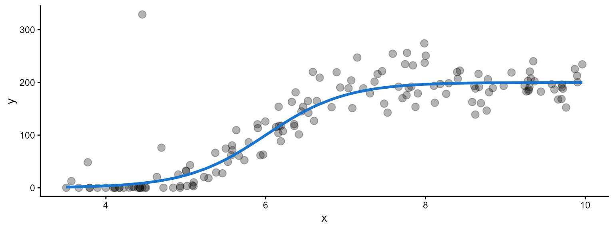

``` r

#Fit model
sigmoidal_mod <- nls(y ~ SSlogis(x, b0, b1, b2), 
                     data = df,
                     control = nls.control(maxiter = 5000, warnOnly = TRUE),
                     start = list(b0 = 200, b1=5, b2=.5))

#Display estimated parameters that are being used in the PPMN
summary(sigmoidal_mod)
#> 
#> Formula: y ~ SSlogis(x, b0, b1, b2)
#> 
#> Parameters:
#>     Estimate Std. Error t value Pr(>|t|)    
#> b0 199.37603    4.89895  40.698  < 2e-16 ***
#> b1   5.94509    0.06874  86.483  < 2e-16 ***
#> b2   0.45420    0.06073   7.478 6.29e-12 ***
#> ---
#> Signif. codes:  0 '***' 0.001 '**' 0.01 '*' 0.05 '.' 0.1 ' ' 1
#> 
#> Residual standard error: 36.76 on 147 degrees of freedom
#> 
#> Number of iterations to convergence: 7 
#> Achieved convergence tolerance: 2.376e-06
```

### Gompertz equation

For the gompertz equation the name is `gompertz`. In this equation, b0
is the asymptote, b1 is the displacement constant and b2 is the growth
rate. This function also allows other parameters to access the equation
$`b_1-x_1+\sum_{p=4}^P( b_p \cdot x_2)`$ similar to the sigmoidal
equation, but has the same curse.

``` math

x_c=b_0 \cdot exp(-exp( b_1 - b_2 \cdot x_p))
```
This equation can also be fitted with the `nls` function.

``` r

#Model parameters
b0 <- 200
b1 <- 6
b2 <- 1

#Independent variables
x  <- runif(150, 3.5, 10)

#Dependent variable
eta <- b0*exp(-exp(b1-b2*x))

#Add some noise
y <- rgamma(length(eta), eta^2/30^2, eta/30^2)

#Create data frame
df <- data.frame(x, y)

#Plot as figure
ggplot(df, aes(x, y))+
  geom_point(size=3, alpha=0.3)+
  geom_line(data=data.frame(x, eta), aes(x, eta), inherit.aes = F,
            col="dodgerblue3", lwd=1.2)+
  theme_classic()
```

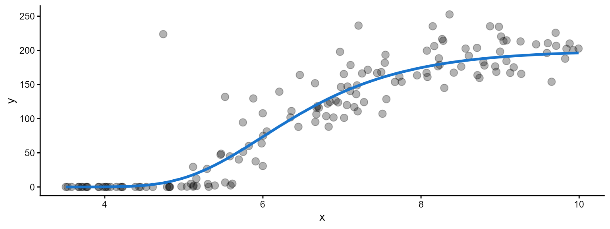

``` r

#Fit model
gompertz_mod <- nls(y ~ b0 * exp(-exp(b1 - b2*x)),
                    data = df,
                    control = nls.control(maxiter = 5000, warnOnly = TRUE),
                    start = list(b0 = 200, b1 = 5, b2 = 1))

#Display estimated parameters that are being used in the PPMN
summary(gompertz_mod)
#> 
#> Formula: y ~ b0 * exp(-exp(b1 - b2 * x))
#> 
#> Parameters:
#>    Estimate Std. Error t value Pr(>|t|)    
#> b0 194.1627     5.5125  35.222   <2e-16 ***
#> b1   6.0553     0.6131   9.877   <2e-16 ***
#> b2   1.0028     0.1028   9.752   <2e-16 ***
#> ---
#> Signif. codes:  0 '***' 0.001 '**' 0.01 '*' 0.05 '.' 0.1 ' ' 1
#> 
#> Residual standard error: 23.17 on 147 degrees of freedom
#> 
#> Number of iterations to convergence: 6 
#> Achieved convergence tolerance: 2.968e-06
```

### Asymptotic-linear

For the asymptotic-linear equation the name is `asymptotic`. In this
equation, b0 is the asymptote, b1 is the displacement constant and b2 is
the growth rate. This function also allows other parameters to access
the equation $`b_1-x_1+\sum_{p=4}^P( b_p \cdot x_2)`$ similar to the
sigmoidal equation, but has the same curse.

``` r

#Model parameters
b0 <- 100
b1 <- 120
b2 <- 0.1

#Independent variables
x  <- runif(150, 1, 100)

#Dependent variable
eta <- b0-b1*exp(-b2*x)

#Add some noise
y <- rgamma(length(eta), eta^2/20^2, eta/20^2)

#Create data frame
df <- data.frame(x, y)

#Plot as figure
ggplot(df, aes(x, y))+
  geom_point(size=3, alpha=0.3)+
  geom_line(data=data.frame(x, eta), aes(x, eta), inherit.aes = F,
            col="dodgerblue3", lwd=1.2)+
  theme_classic()
```

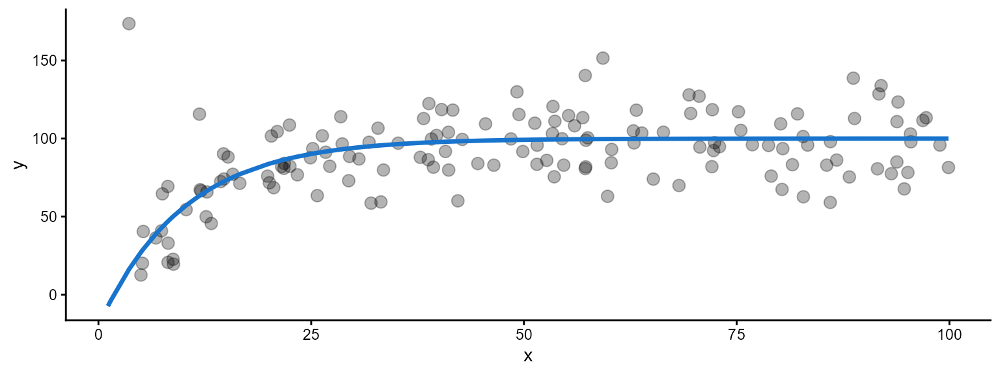

``` r

#Fit model
asymptotic_mod <- nls(
  y ~ b0 - b1 * exp(-b2 * x),
  data = df,
  control = nls.control(maxiter = 5000, warnOnly = TRUE),
  start = list( b0 = 200, b1 = 120, b2 = 0.1))

#Display estimated parameters that are being used in the PPMN
summary(asymptotic_mod)
#> 
#> Formula: y ~ b0 - b1 * exp(-b2 * x)
#> 
#> Parameters:
#>    Estimate Std. Error t value Pr(>|t|)    
#> b0 99.94790    3.03751  32.905  < 2e-16 ***
#> b1 73.36539   13.89744   5.279 4.69e-07 ***
#> b2  0.06485    0.01898   3.417 0.000822 ***
#> ---
#> Signif. codes:  0 '***' 0.001 '**' 0.01 '*' 0.05 '.' 0.1 ' ' 1
#> 
#> Residual standard error: 21.94 on 144 degrees of freedom
#> 
#> Number of iterations to convergence: 15 
#> Achieved convergence tolerance: 4.891e-06
#>   (3 observations deleted due to missingness)
```

### Gaussian equation

For the Gaussian equation the name is `gaussian`. b0 represents the peak
(max), b1 the mean and b2 the standard deviation.

``` math

x_c = b_0 \cdot exp(-0.5 \cdot (\frac{(x - b_1)}{b_2})^2)
```

``` r

#Model parameters
b0 <- 200
b1 <- 6
b2 <- 1

#Independent variables
x  <- runif(150, 1.5, 9)

#Dependent variable
eta <- b0*exp(-0.5*((x-b1)/b2)^2)

#Add some noise
y <- rgamma(length(eta), eta^2/30^2, eta/30^2)

#Create data frame
df <- data.frame(x, y)

#Plot as figure
ggplot(df, aes(x, y))+
  geom_point(size=3, alpha=0.3)+
  geom_line(data=data.frame(x, eta), aes(x, eta), inherit.aes = F,
            col="dodgerblue3", lwd=1.2)+
  theme_classic()
```

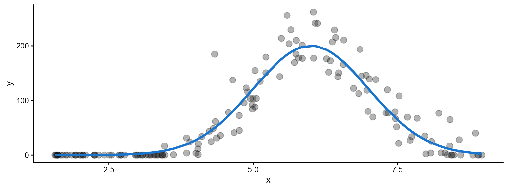

``` r

#Fit model
gaussian_mod <- nls(y ~ b0 * exp(-0.5 * ((x - b1)/b2)^2),
  data = df,
  control = nls.control(maxiter = 5000, warnOnly = TRUE),
  start = list(b0 = 200,b1 = 6, b2 = 1.5))

#Display estimated parameters that are being used in the PPMN
summary(gaussian_mod)
#> 
#> Formula: y ~ b0 * exp(-0.5 * ((x - b1)/b2)^2)
#> 
#> Parameters:
#>     Estimate Std. Error t value Pr(>|t|)    
#> b0 195.79702    4.78229   40.94   <2e-16 ***
#> b1   6.02269    0.03004  200.49   <2e-16 ***
#> b2   1.03777    0.02843   36.51   <2e-16 ***
#> ---
#> Signif. codes:  0 '***' 0.001 '**' 0.01 '*' 0.05 '.' 0.1 ' ' 1
#> 
#> Residual standard error: 23.45 on 147 degrees of freedom
#> 
#> Number of iterations to convergence: 4 
#> Achieved convergence tolerance: 4.095e-07
```

### Bayesian classifier

The Bayesian classifier is an equation that makes use of the mean and
standard deviation of two groups. There is no process of fitting with
maximum likelihood necessary. The name of this edge function is `class`.
In this equation b0 and b1 are the mean and standard deviation of group
1, respectively. b2 and b3 are the mean and standard deviation of group
2. b5 is the proportion of group 1.

``` math

x_c = Log(\frac{N(x_p | b_0, b_1)}{N(x_p | b_2, b_3)})\cdot Log(\frac{b_4}{1-b_4})
```

For the sake of displaying the pattern.

``` r

#Model parameters
b0 <- 20
b1 <- 5
b2 <- 100
b3 <- 25
b4 <- 0.5

#Independent variables
x  <- runif(150, 10, 80)

#Dependent variable
p   <- exp(dnorm(x, b0, b1, log=T) - dnorm(x, b2, b3, log=T))
eta <- (p*b4)/((p*b4)+(1-b4))

#Add some noise
y <- rbinom(length(eta), 1, eta)

#Create data frame
df <- data.frame(x, y)

#Plot as figure
ggplot(df, aes(x, y))+
  geom_point(size=3, alpha=0.3)+
  geom_line(data=data.frame(x, eta), aes(x, eta), inherit.aes = F,
            col="dodgerblue3", lwd=1.2)+
  theme_classic()
```

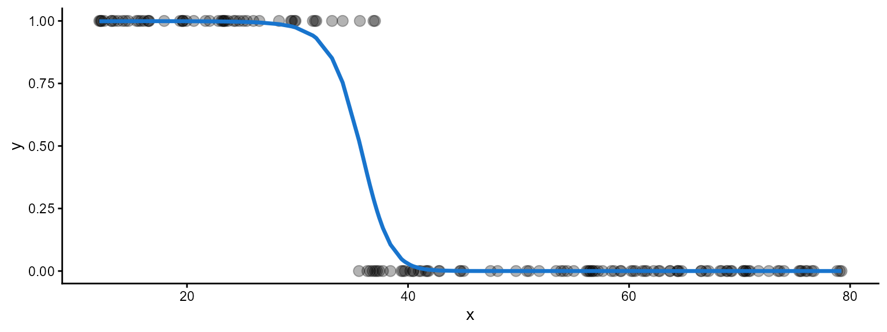

## Disclaimer: Statistical and causal interpretation

The updating procedure produces a generalized posterior distribution by
combining prior information with a loss function rather than a formally
specified likelihood. Consequently, although the resulting distribution
provides a probabilistic representation of updated parameter
uncertainty, it should not automatically be interpreted as a
conventional/orthodox Bayesian posterior. In particular, generalized
posterior probabilities and credible intervals do not necessarily
possess the calibration properties associated with a correctly specified
likelihood-based Bayesian model.

At its current stage of development, the PPMN is primarily an
exploratory and predictive framework, not a method for attribution of
causal claims. The directed relationships within the network represent
assumed dependencies derived from existing literature, ecological
knowledge, and theoretical expectations. Some relationships may reflect
well-established mechanisms, such as the influence of pH on carbonate
speciation and the relative abundance of dissolved CO₂ and bicarbonate
(HCO₃⁻). However, these relationships are specified a priori (front to
back) rather than inferred as causal relationships from the data (back
to front). Consequently, neither the direction of an edge nor changes in
predicted responses should, by themselves, be interpreted as evidence
that one variable causes another to change.

Using the term causal (or effect as follows from a cause) requires more
than specifying the direction of dependencies within a network. It
depends on whether the assumptions necessary for causal identification
are satisfied, including positivity, adequate control of confounding,
and the absence of relevant omitted confounders. Consequently, although
a network may incorporate relationships supported by established causal
mechanisms, it does not independently identify or if the term cause (or
effect) are justified.
